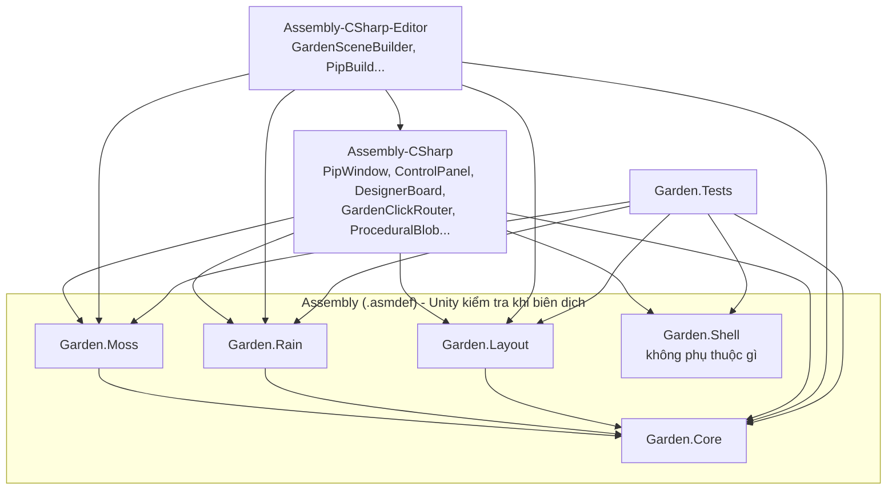
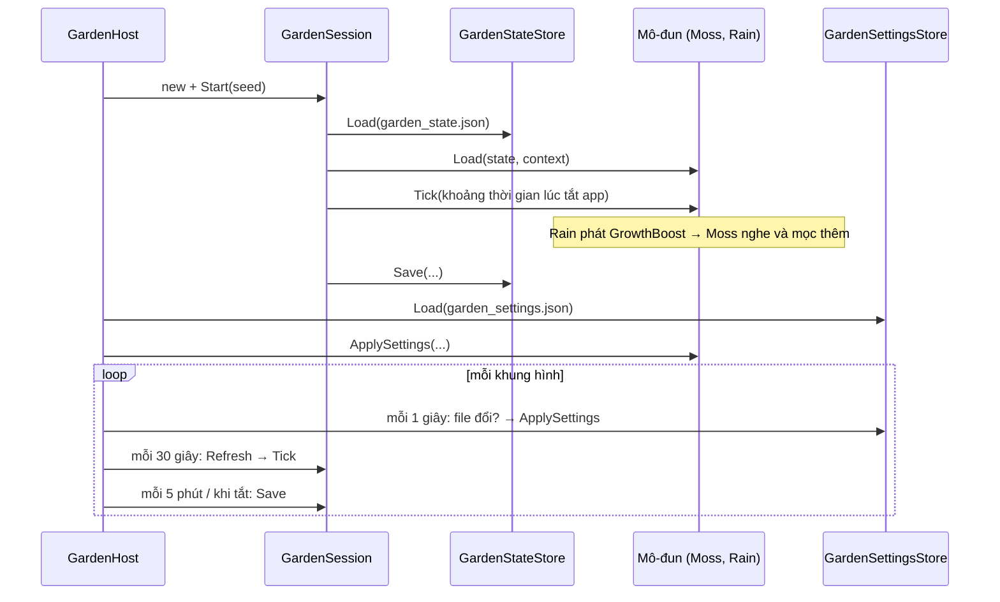

# Kiến trúc dự án Garden Chill (garden_chillguy)

> Tài liệu cho lập trình viên mới. Viết từ việc đọc toàn bộ mã nguồn ở commit `f6fef63`.
> Dự án đã có sẵn `Docs/ARCHITECTURE.md` (hướng dẫn viết mô-đun mới) và `Docs/ART_WORKFLOW.md` (quy trình làm art).
> File này là bản tổng quan, đọc trước; hai file kia đi sâu hơn.

## Dự án này là gì

Đây **không phải** game hành động. Không có nhân vật, máu, tấn công, vật phẩm hay màn chơi.
Đây là một "khu vườn thư giãn" chạy liên tục trên màn hình máy tính, gồm **hai app Windows**:

| App | Scene | Vai trò |
|---|---|---|
| **Aquarium** (cửa sổ vườn) | `Assets/cozy garden.unity` | Cửa sổ nhỏ kiểu PIP (picture-in-picture): không viền, luôn nổi trên các app khác, ẩn khỏi taskbar. Hiện một góc vườn có tảng đá phủ rêu. Rêu mọc theo **thời gian thật** (kể cả lúc tắt app), trời có mưa. Người chơi click vào đá để bóc rêu, rêu tự lành sau vài ngày. |
| **ControlPanel** | `Assets/ControlPanel.unity` | Cửa sổ điều khiển: bật/tắt/ẩn/hiện cửa sổ vườn (tab "Điều khiển") và chỉnh vườn (tab "Thiết kế": bố cục, mưa, tốc độ rêu). |

Hai app nói chuyện với nhau bằng 2 cách:
- **Lệnh** (hiện/ẩn/tắt/hỏi trạng thái): gói tin UDP trên `127.0.0.1:47321`.
- **Cài đặt thiết kế**: Control Panel ghi file JSON, cửa sổ vườn kiểm tra file mỗi giây và áp dụng ngay.

## 1. Engine, phiên bản, ngôn ngữ

| Mục | Giá trị | Nguồn |
|---|---|---|
| Engine | Unity **6000.6.4f1** (Unity 6) | `ProjectSettings/ProjectVersion.txt` |
| Render pipeline | URP (Universal Render Pipeline) **17.6.0**, không gian màu Linear | `Packages/manifest.json`, `Assets/Settings/GardenURP.asset` |
| Nền tảng build | Windows 64-bit, Direct3D 11 (không dùng DX12 vì treo khi tắt, xem `Docs/ART_WORKFLOW.md`) | `Assets/Editor/PipBuild.cs` |
| Ngôn ngữ game | **C#** | `Assets/script/**`, `Assets/Editor/**` |
| Shader | **HLSL** (ShaderLab cho URP) | `Assets/Shaders/`, `Assets/script/Garden/Modules/*/Shaders/` |
| Công cụ art | **Python** (chạy trong Blender hoặc Python có numpy; một script dùng Stable Diffusion) | `Art/blender_scripts/` |
| Test | NUnit qua Unity Test Framework, chế độ **EditMode** | `Assets/Tests/EditMode/` |
| Giao diện | IMGUI (`OnGUI`), không dùng uGUI hay UI Toolkit | `ControlPanel.cs`, `PipTitleBar.cs`, `*DesignerPanel.cs` |
| Gói thư viện thêm | `com.unity.mathematics` (noise), `com.unity.ai.assistant` 2.20.0-**pre**.1, `com.unity.pipeline` 0.8.0-**exp**.1 | `Packages/manifest.json` |

## 2. Cây thư mục chính

```text
garden_chillguy/
├── Assets/                         Mọi thứ Unity nhập vào
│   ├── cozy garden.unity           Scene cửa sổ vườn (Aquarium)
│   ├── ControlPanel.unity          Scene Control Panel
│   ├── script/                     Mã nguồn chạy trong game
│   │   ├── *.cs                    "Vỏ" app: cửa sổ PIP, lệnh UDP, Control Panel, chặn chạy 2 bản
│   │   ├── Shell/                  Garden.Shell: logic thuần chia vùng chuột của cửa sổ PIP (có test)
│   │   └── Garden/
│   │       ├── Core/               Garden.Core: khung mô-đun, file lưu, file cài đặt, đồng hồ, sự kiện, click
│   │       ├── Modules/
│   │       │   ├── Moss/           Garden.Moss: rêu mọc, bị bóc, tự lành (+ shader GhibliRockMoss)
│   │       │   ├── Rain/           Garden.Rain: lịch mưa, hạt mưa, ánh sáng dịu (+ shader GardenRainStreak)
│   │       │   └── Layout/         Garden.Layout: đổi hình đá, ẩn/hiện nấm, cỏ, lá
│   │       └── *.cs                Sinh hình bằng code (đá, cỏ, sỏi) + nhận click vào vườn
│   ├── Editor/                     Công cụ chỉ chạy trong Unity Editor (menu Tools/Garden): dựng scene, build, xuất OBJ, ...
│   ├── Tests/EditMode/             184 test tự động (Garden.Tests)
│   ├── Shaders/                    Shader toon kiểu Ghibli dùng chung
│   ├── Garden/                     Asset của vườn: Materials/, Textures/ (PNG), Models/ (Boulder.fbx), GardenVolume.asset
│   └── Settings/                   Cấu hình URP (pipeline, renderer)
├── Art/
│   ├── boulder.blend               File Blender gốc của tảng đá chính (qua Git LFS)
│   └── blender_scripts/            Script Python: retopo, UV, vẽ texture đá, sinh tile bằng AI
├── Docs/                           ARCHITECTURE.md (cách viết mô-đun), ART_WORKFLOW.md (quy trình art)
├── Packages/                       Danh sách gói Unity (manifest.json, packages-lock.json)
├── ProjectSettings/                Cài đặt dự án Unity
├── CLAUDE.md, update-graph.ps1     Hướng dẫn cho trợ lý AI + script cập nhật đồ thị tri thức (graphify)
└── .gitignore, .gitattributes, .editorconfig
```

Thư mục **không** nằm trong Git (sinh lại được): `Library/`, `Temp/`, `Logs/`, `UserSettings/`, `Exports/` (file xuất cho Maya/ảnh xem thử), `graphify-out/`, `Docs/reference/` (ảnh tham chiếu của bên thứ ba).
Bản build nằm ở `../../Builds` tính từ `Assets`, tức là **bên ngoài** thư mục repo.

## 3. Các module/script chính

Unity chia code thành các "assembly" bằng file `.asmdef`. Mỗi assembly là một khối biên dịch riêng, và Unity **cấm** một assembly dùng code của assembly mà nó không khai báo. Nhờ vậy quy tắc phụ thuộc được trình biên dịch kiểm tra giúp.

### Garden.Core (`Assets/script/Garden/Core/`)
Bộ khung chung, **không biết** mô-đun cụ thể nào (trừ một ngoại lệ cho file lưu bản cũ, xem `GardenStateMigrator`).

| File | Nhiệm vụ |
|---|---|
| `GardenModule.cs` | Các interface: `IGardenModule` (Load/Save/Tick), `IAgePreviewable`, `IGardenClickHandler`, `IGardenConfigurable`, `IGardenDesignerPanel`; struct `GardenContext`, `GardenClick`. |
| `GardenHost.cs` | MonoBehaviour gắn vào object `Garden`. Tìm mọi mô-đun con, tạo `GardenSession`, cứ 30 giây cho thời gian trôi, 5 phút lưu một lần, mỗi giây kiểm tra file cài đặt. |
| `GardenSession.cs` | Lớp thuần (không phải MonoBehaviour), điều phối một lần chơi: đọc file lưu, cho mô-đun nạp dữ liệu, tính thời gian đã trôi khi tắt app, gom dữ liệu và ghi **một** file. Mô-đun lỗi không kéo sập mô-đun khác. |
| `GardenState.cs` | Dữ liệu file lưu: phiên bản, seed, thời điểm, và mảng `sections` (mỗi mô-đun một phần JSON riêng). |
| `GardenStateStore.cs` | Đọc/ghi file lưu, sao lưu `.bad` / `.newer` / `.pre-v2.bak` khi gặp file hỏng/mới hơn/cũ. Chứa `GardenPaths` (đường dẫn file). |
| `GardenStateMigrator.cs` | Nâng cấp file lưu bản 1 lên bản 2. |
| `GardenSettings.cs` | Dữ liệu và đọc/ghi file cài đặt người chơi (cùng cấu trúc "mỗi mô-đun một phần"). |
| `GardenSections.cs` | Hàm dùng chung cho `GardenState` và `GardenSettings`: lấy/thay/kiểm tra phần của mô-đun. |
| `SafeFile.cs` | Ghi file an toàn (ghi file tạm rồi thay thế) và sao lưu. |
| `DebouncedSettingsWriter.cs` | Gộp nhiều lần kéo thanh trượt thành một lần ghi file, thử lại khi lỗi. |
| `GardenClock.cs`, `TimeWindow.cs` | Tính khoảng thời gian đã trôi (tối đa 365 ngày, bỏ qua khi đồng hồ bị chỉnh lùi). |
| `GardenEventBus.cs`, `GardenEvents.cs` | Kênh sự kiện để mô-đun báo cho nhau mà không gọi trực tiếp. Sự kiện: `GrowthBoost` (mưa giúp cây mọc), `GardenDisturbance` (người chơi làm phiền vườn). |
| `ClickDispatcher.cs`, `ConfigurableApplier.cs` | Chuyển click / cài đặt cho mọi mô-đun, mô-đun lỗi không chặn mô-đun khác. |
| `GardenArgs.cs` | Đọc tham số dòng lệnh cho dev (`-gardenAgeDays`, `-gardenStateFile`, ...). |
| `DevScreenshot.cs` | Dev: tự chụp màn hình bản build rồi thoát. |

### Garden.Moss (`Assets/script/Garden/Modules/Moss/`)
| File | Nhiệm vụ |
|---|---|
| `MossModule.cs` | Mô-đun rêu: giữ tuổi rêu và vết bóc, lưu vào phần `moss`, nhận click để bóc rêu, nghe `GrowthBoost`. |
| `MossSimulation.cs` | Logic thuần: tuổi rêu → độ phủ (đường cong mềm). Chứa `MossSettings` mặc định. |
| `MossDamage.cs` | Logic thuần: danh sách tối đa 16 vết bóc, gộp vết gần nhau, lành dần. |
| `MossGrowth.cs` | Phần hiển thị: đẩy độ phủ, seed và vết bóc vào shader. |
| `MossDesignerPanel.cs` | Mục "Rêu" trong bảng thiết kế của Control Panel. |
| `Shaders/GhibliRockMoss.shader` | Shader đá phủ rêu (chiếu 3 mặt phẳng, mép rêu xù, vết bóc). |

### Garden.Rain (`Assets/script/Garden/Modules/Rain/`)
| File | Nhiệm vụ |
|---|---|
| `RainModule.cs` | Mô-đun mưa: có đang mưa không, độ lớn mưa lên xuống từ từ, phát `GrowthBoost` cho phần thời gian có mưa. Không lưu gì. |
| `RainSchedule.cs` | Logic thuần: lịch mưa **xác định** theo seed (ô 6 giờ, mỗi ô có thể có 1 trận 20-90 phút). Chứa `RainSettings`. |
| `RainView.cs` | Hiển thị: số hạt mưa, làm tối/ngả xanh ánh sáng mặt trời. |
| `RainDesignerPanel.cs` | Mục "Mưa" trong bảng thiết kế. |
| `Shaders/GardenRainStreak.shader` | Shader vệt mưa. |

### Garden.Layout (`Assets/script/Garden/Modules/Layout/`)
| File | Nhiệm vụ |
|---|---|
| `LayoutCatalog.cs` | **Một** danh sách các vị trí tuỳ chỉnh được (đá chính, 4 đá nhỏ, nấm, cỏ, lá). |
| `LayoutSlot.cs` | Component đánh dấu một vật là vị trí tuỳ chỉnh. |
| `GardenLayout.cs` | Áp dụng bố cục người chơi chọn: ẩn/hiện, đổi hình. |
| `LayoutSettings.cs`, `ILayoutVariant.cs` | Dữ liệu cài đặt bố cục; interface cho vật đổi hình được. |
| `LayoutDesignerPanel.cs` | Mục "Bố cục" trong bảng thiết kế. |

### Garden.Shell (`Assets/script/Shell/`)
| File | Nhiệm vụ |
|---|---|
| `PipHitTest.cs` | Logic thuần (không dùng Unity): điểm chuột thuộc vùng nào của cửa sổ PIP (vườn, thanh tiêu đề, nút, mép). |

### Assembly-CSharp (phần "vỏ" app, `Assets/script/*.cs` và `Assets/script/Garden/*.cs`)
| File | Nhiệm vụ |
|---|---|
| `PipWindow.cs` | Gọi Win32 API: bỏ viền cửa sổ, luôn nổi, ẩn khỏi taskbar, kéo/đổi cỡ bằng chuột, chặn Alt+F4, mở Control Panel. |
| `PipTitleBar.cs` | Thanh tiêu đề hiện dần khi rê chuột, 3 nút Ẩn / Control Panel / Tắt. |
| `PipResizeCursors.cs` | Tự vẽ con trỏ mũi tên đổi kích thước. |
| `PipBounds.cs` | Nhớ vị trí và kích thước cửa sổ (PlayerPrefs). |
| `PipCommandServer.cs` | Nghe lệnh UDP từ Control Panel ở luồng riêng, thực hiện ở luồng chính. |
| `PipProtocol.cs`, `AppNames.cs` | Hằng số: cổng, tên lệnh, tên app. |
| `SingleInstance.cs` | Mutex: mỗi app chỉ chạy một bản. |
| `AppSetup.cs` | Đặt 30 FPS, chạy nền. |
| `ControlPanel.cs` | App Control Panel: luồng hỏi trạng thái mỗi giây, 2 tab. |
| `DesignerBoard.cs` | Bảng thiết kế: vẽ bảng của từng mô-đun, ghi file cài đặt. |
| `GardenClickRouter.cs` | Biến click chuột trái thành tia từ camera, báo cho `GardenHost`. |
| `Garden/ProceduralBlob.cs` | Sinh khối đá/bụi cây từ seed; có ô "Override Mesh" để dùng mô hình từ Blender/Maya. |
| `Garden/BlobMeshBuilder.cs` | Dựng mesh từ hình cầu 20 mặt + noise. |
| `Garden/GrassTuft.cs` | Sinh bụi cỏ bằng code. |
| `Garden/BlobScatter.cs` | Rải sỏi/hoa vào một mesh (hiện **không dùng**). |
| `GrowTest.cs` | Script thử nghiệm cũ (hiện **không dùng**). |

### Editor (`Assets/Editor/`, chỉ chạy trong Unity Editor)
| File | Menu | Nhiệm vụ |
|---|---|---|
| `PipBuild.cs` | Tools/Garden/1, 2 | Gắn component vào scene, build 2 app. |
| `GardenSceneBuilder.cs` | Tools/Garden/3 | Dựng lại toàn bộ góc vườn bằng code (vật liệu, đá, cỏ, nấm, mưa, ánh sáng, camera, hậu kỳ). |
| `GardenTextureGenerator.cs` | (gọi từ 3) | Sinh 3 texture mẫu lặp liền mạch. |
| `PaintedBoulderSetup.cs` | Use painted boulder | Thay tảng đá chính bằng `Boulder.fbx` vẽ tay. |
| `RockPreview.cs` | Preview painted boulder | Chụp ảnh xem thử tảng đá. |
| `GardenExport.cs` | Export rocks to OBJ | Xuất đá ra OBJ cho Maya. |
| `GardenDevTools.cs` | Tools/Garden/Dev/... | Xem thử rêu ngày N, xem thử mưa, xóa file lưu của Editor. |

## 4. Sơ đồ phụ thuộc

Mũi tên `A --> B` nghĩa là "A dùng code của B".



Không có phụ thuộc vòng tròn. Các mô-đun (Moss, Rain, Layout) **không** tham chiếu nhau; chúng chỉ nói chuyện qua `GardenEventBus`.

### Luồng chạy của cửa sổ vườn (Aquarium)



### Luồng click và luồng lệnh

```text
Chuột trái
  → PipWindow.Update: PipHitTest.Classify (vùng nào?)
      ├─ mép        → đổi kích thước cửa sổ (Win32 SetWindowPos)
      ├─ thanh tiêu đề → kéo cửa sổ
      ├─ nút        → PipTitleBar.OnGUI (Ẩn / Control Panel / Tắt)
      └─ vườn       → GardenClickRouter: Physics.Raycast từ camera
                         → GardenHost.DispatchClick → ClickDispatcher
                             → MossModule.OnGardenClick → MossDamage.AddHit → MossGrowth (shader)
                                                         → EventBus.Publish(GardenDisturbance)

ControlPanel (luồng nền, mỗi 1 giây) ──UDP "ping"──▶ PipCommandServer ──"pong visible/hidden"──▶
ControlPanel (nút bấm)               ──UDP "show/hide/quit"──▶ PipCommandServer → hàng đợi → PipWindow.Show/Hide/Quit
ControlPanel tab Thiết kế → DesignerBoard → *DesignerPanel.Draw → DebouncedSettingsWriter → garden_settings.json
                                                                  ↓ (GardenHost kiểm tra mỗi giây)
                                                    GardenLayout / RainModule / MossModule.ApplySettings
```

## 5. Dữ liệu game nằm ở đâu, dạng gì

Dự án không có chỉ số nhân vật, vật phẩm hay màn chơi. Dữ liệu tương đương là:

| Loại dữ liệu | Nằm ở đâu | Dạng |
|---|---|---|
| Thông số mặc định của rêu (14 ngày phủ đầy, độ phủ 0.1 → 0.5, bán kính bóc 0.45 m, lành sau 2 ngày) | `MossSettings.Default` trong `MossSimulation.cs`, được chép vào field serialized của `MossModule` trong scene | Code C# + YAML scene |
| Thông số mưa (xác suất mưa theo tần suất 12/25/45%, ô 6 giờ, trận 20-90 phút) | Hằng số trong `RainSchedule.cs`; hệ số tăng tốc mọc (3x), thời gian mưa lên/tạnh là field serialized của `RainModule` | Code C# + YAML scene |
| Vị trí, kích thước, seed của đá, nấm, cỏ, lá; màu vật liệu; ánh sáng; camera | Mảng số viết cứng trong `Assets/Editor/GardenSceneBuilder.cs`, được "nướng" vào `Assets/cozy garden.unity` khi chạy menu dựng scene | Code C# → YAML scene |
| Danh sách vị trí tuỳ chỉnh được | `LayoutCatalog.cs` | Code C# |
| Vật liệu, texture, mô hình | `Assets/Garden/Materials/*.mat`, `Textures/*.png`, `Models/Boulder.fbx` | Asset Unity (PNG/FBX qua Git LFS) |
| Lựa chọn của người chơi (bố cục, mưa, tốc độ rêu) | `%LOCALAPPDATA%\GardenChill\garden_settings.json` (Editor: `garden_settings.editor.json`) | JSON (`JsonUtility`) |
| Tiến trình vườn (tuổi rêu, vết bóc, seed, lần cuối mở app) | `%LOCALAPPDATA%\GardenChill\garden_state.json` (Editor: `garden_state.editor.json`) | JSON (`JsonUtility`) |
| Vị trí và kích thước cửa sổ PIP | `PlayerPrefs` khoá `pip.bounds` (trên Windows là Registry `HKCU\Software\DefaultCompany\Aquarium`) | Chuỗi `"x,y,rộng,cao"` |

## 6. Cách lưu/tải game (save/load)

**Chỉ một nơi đọc/ghi file lưu: `GardenSession`.** Mô-đun không tự ghi file.

Cấu trúc file `garden_state.json` (phiên bản 2):

```json
{
  "version": 2,
  "seed": 12345,
  "createdTicksUtc": 638900000000000000,
  "lastSeenTicksUtc": 638900500000000000,
  "sections": [
    { "id": "moss", "json": "{\"ageDays\":3.2,\"hits\":[...]}" }
  ]
}
```

**Khi mở app** (`GardenHost.Start` → `GardenSession.Start`):
1. `GardenStateStore.Load` đọc file:
   - Không có file → tạo vườn mới với seed ngẫu nhiên.
   - Bản hiện tại → dùng luôn.
   - Bản 1 (cũ) → `GardenStateMigrator` nâng cấp, sao lưu file cũ thành `.pre-v2.bak`.
   - Hỏng → sao lưu `.bad`, tạo vườn mới.
   - Do bản app mới hơn tạo → sao lưu `.newer`, tạo vườn mới.
2. Mỗi mô-đun `Load` phần của mình (thiếu thì dùng mặc định).
3. Tính khoảng thời gian từ `lastSeenTicksUtc` tới bây giờ (tối đa 365 ngày, đồng hồ chỉnh lùi thì bỏ qua) và cho mọi mô-đun `Tick` khoảng đó: rêu già thêm, vết bóc lành, mưa lúc tắt app được cộng vào.
4. Lưu ngay một lần.

**Khi đang chạy:** mỗi 30 giây `Refresh` (cho thời gian trôi); mỗi 5 phút, khi app bị tạm dừng và khi tắt app thì `Save`.

**Khi lưu** (`GardenSession.Save`): chạy nốt thời gian chưa tính, gom phần của từng mô-đun (phần của mô-đun lạ/chưa nạp được giữ nguyên), rồi `SafeFile.WriteAtomically`: ghi ra `garden_state.json.tmp` rồi thay thế file cũ, nên mất điện giữa chừng không làm hỏng file cũ.

**Chế độ xem thử** (`-gardenAgeDays N` hoặc menu Dev): không bao giờ ghi file.

**File cài đặt** `garden_settings.json` dùng cùng cách chia phần và cùng cách ghi an toàn, nhưng do Control Panel ghi (sau khi người chơi ngừng chỉnh 0.25 giây), còn cửa sổ vườn chỉ đọc.

**Đổi định dạng file lưu:** tăng `GardenState.CurrentVersion`, thêm nhánh nâng cấp trong `GardenStateMigrator` kèm test. Thêm field mới vào phần riêng của mô-đun thì **không** cần tăng phiên bản.

> Có 3 điểm yếu trong luồng lưu/tải, chi tiết trong `AUDIT_REPORT.md` mục D:
> lỗi đọc file tạm thời có thể ghi đè vườn thật; mưa lúc tắt app tính theo cài đặt mặc định; lỗi đọc file cài đặt làm vườn quay về cài đặt mặc định.
